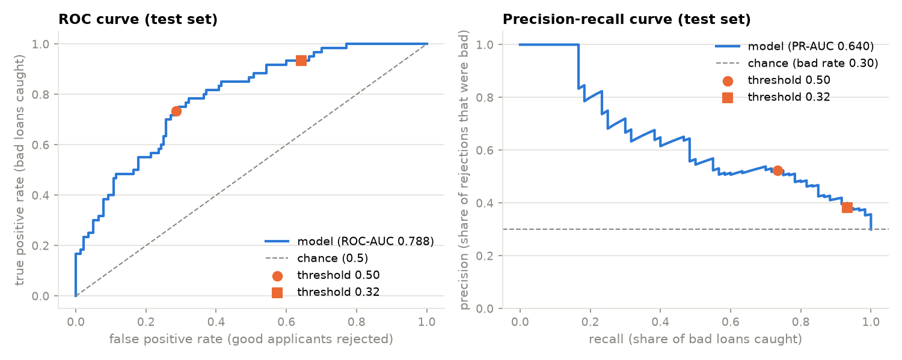
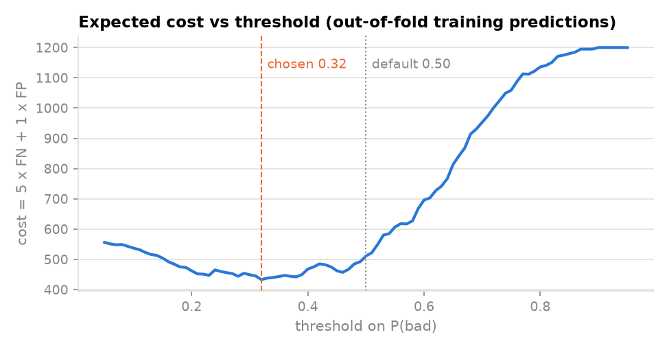

# Credit risk analysis: German Credit, scikit-learn pipeline, Streamlit app

[](https://github.com/Redskull2525/credit-risk-analysis-ml/actions/workflows/tests.yml)

**Live app:** https://credit-risk-analysis-ml-abhishek.streamlit.app/

A small, honest, end-to-end applied-ML project: predict whether a loan applicant will turn out to be a
*bad* credit (not repay) from 17 application attributes, choose the decision threshold with an explicit
cost model, document the limits, and serve the model in a Streamlit app whose form is generated from the
saved model so the two cannot drift apart.

* 1,000 applications (German Credit data, CC BY 4.0), 30% bad.
* Logistic Regression vs Random Forest, compared with 5-fold stratified cross-validation.
* Test ROC-AUC **0.788**, PR-AUC **0.640**; at the cost-based threshold the model catches **93%** of bad loans.
* 20 pytest tests, GitHub Actions on Python 3.12 and 3.13, generated model card, executed notebook.
* **Learning project, not a lending tool.** Every number below comes from one run of `python src/train.py`.

---

## 1. Business problem

A bank that lends money loses the principal when a borrower defaults, and loses only the interest margin
when it turns away someone who would have repaid. Credit scoring ranks applicants by their probability of
default so that the bank can decide whom to approve, whom to refer to a human underwriter, and what to
charge. Two things matter beyond "is the model accurate":

1. **Ranking quality** (ROC-AUC, PR-AUC): does the model put the risky applicants above the safe ones?
2. **The operating point**: at which score does the bank say no? Missing a bad loan costs far more than
   rejecting a good applicant, so the threshold is a business decision, not 0.5 by default.

## 2. Dataset and licence

| | |
|---|---|
| Name | German Credit (OpenML `credit-g` v1 = UCI *Statlog (German Credit Data)*) |
| Size | 1,000 rows x 20 attributes + target; 700 good / 300 bad |
| Source | downloaded with `sklearn.datasets.fetch_openml("credit-g", version=1)`, no account needed; the CSV is committed in `data/` |
| Licence | **CC BY 4.0**. Citation: Hofmann, H. (1994). Statlog (German Credit Data). UCI ML Repository. https://doi.org/10.24432/C5NC77 |
| Column dictionary | [`data/README.md`](data/README.md) |

The dataset's authors also published a cost matrix: misclassifying a **bad** applicant as good costs **5**,
misclassifying a good applicant as bad costs **1**. This project uses that ratio as its explicit cost assumption.

**Why not the Kaggle data from version 1 of this repo?** The original 11-feature schema (`person_age`,
`person_income`, `loan_grade`, ...) came from a Kaggle dataset that needs a login to download and whose licence
does not clearly allow redistribution, so the training could never be reproduced. It was dropped in favour of
a public, licensed dataset that is small enough to commit.

## 3. What is in the repository

```
app.py                         Streamlit app (form generated from the saved feature list)
src/data.py                    feature lists, plain-English labels, download/load helpers
src/scoring.py                 cost assumptions, threshold search, decide(), load_bundle()
src/train.py                   split -> CV comparison -> threshold -> single test evaluation -> save
data/german_credit.csv         the data (+ data/README.md with source, licence, columns)
models/credit_pipeline.pkl     fitted Pipeline + metadata (features, threshold, metrics, sklearn version)
reports/metrics.json           every metric from the run
reports/model_card.md          generated model card (data, metrics, fairness, limitations)
reports/logistic_coefficients.csv   odds ratios of the logistic-regression candidate
reports/figures/               plots saved by the notebook
notebooks/credit_risk_eda_and_training.ipynb   EDA + the same training code, executed with outputs
tests/                         20 pytest tests (pipeline, artifact, threshold logic, Streamlit AppTest)
docs/INTERVIEW_GUIDE.md        how to explain and defend this project
.github/workflows/tests.yml    CI: pytest on Python 3.12 and 3.13, then a from-scratch retrain
```

## 4. Pipeline

```mermaid
flowchart LR
    A["data/german_credit.csv<br/>1,000 rows, 17 inputs"] --> B["Stratified split<br/>800 train / 200 test<br/>random_state=42"]
    B --> C["ColumnTransformer<br/>StandardScaler (6 numeric)<br/>OneHotEncoder (11 categorical)"]
    C --> D["5-fold stratified CV<br/>on the training set"]
    D --> E["Logistic Regression<br/>class_weight=balanced"]
    D --> F["Random Forest<br/>class_weight=balanced"]
    E --> G["Pick highest<br/>mean ROC-AUC"]
    F --> G
    G --> H["Threshold = min expected cost<br/>on out-of-fold train predictions<br/>(FN cost 5, FP cost 1)"]
    H --> I["Fit on all training rows<br/>evaluate ONCE on test"]
    I --> J["models/credit_pipeline.pkl<br/>reports/metrics.json<br/>reports/model_card.md"]
    J --> K["app.py<br/>form built from saved features<br/>decision at saved threshold"]
```



Protected attributes in the data (`age`, `personal_status` = sex/marital status, `foreign_worker`) are
**not** model inputs; see section 8.

## 5. How to run

```bash
git clone https://github.com/Redskull2525/credit-risk-analysis-ml
cd credit-risk-analysis-ml
python -m venv .venv
.venv\Scripts\activate            # Windows   (macOS/Linux: source .venv/bin/activate)
pip install -r requirements-dev.txt

python src/data.py                # optional: re-download data/german_credit.csv from OpenML
python src/train.py               # about a minute; rewrites models/ and reports/
pytest -v                         # 20 tests
streamlit run app.py              # the app, at http://localhost:8501
```

The notebook (`notebooks/credit_risk_eda_and_training.ipynb`) opens in VS Code or JupyterLab; it imports
`src.train.run_training` so it runs exactly the script's code (with `save=False`).

`requirements.txt` is the runtime set the Streamlit app needs (and what Streamlit Community Cloud installs),
pinned to the versions the model was trained with; `requirements-dev.txt` adds pytest, matplotlib and the
notebook tooling. The test `test_sklearn_version_matches_artifact` fails loudly if the installed scikit-learn
is not the one that produced the pickle.

## 6. Results (from `python src/train.py`, 2026-10-19, scikit-learn 1.9.1)

### Model comparison, 5-fold stratified CV on the 800 training rows

| Candidate | CV ROC-AUC (mean +/- std) | CV PR-AUC | |
|---|---|---|---|
| Logistic Regression (`class_weight="balanced"`) | 0.781 +/- 0.067 | 0.624 | |
| Random Forest (500 trees, `min_samples_leaf=3`, `class_weight="balanced"`) | **0.793 +/- 0.065** | 0.661 | selected |

The gap (0.012) is far smaller than the fold-to-fold spread, so the two models are statistically hard to
separate on 800 rows. The script picks by the rule it declares (highest mean ROC-AUC); the logistic regression
stays in the repo as the interpretable baseline (section 7).

### Test set (200 applications, 60 bad), evaluated once

"bad" is the positive class. Cost = 5 x missed bad loans + 1 x rejected good applicants.

| Operating point | ROC-AUC | PR-AUC | Precision (bad) | Recall (bad) | F1 (bad) | Accuracy | TN / FP / FN / TP | Rejected | Cost |
|---|---|---|---|---|---|---|---|---|---|
| Threshold 0.50 (default) | 0.788 | 0.640 | 0.524 | 0.733 | 0.611 | 0.720 | 100 / 40 / 16 / 44 | 42% | 120 |
| Threshold **0.32** (cost-based) | 0.788 | 0.640 | 0.384 | **0.933** | 0.544 | 0.530 | 50 / 90 / 4 / 56 | 73% | **110** |
| Baseline: approve everyone | - | - | - | 0.000 | - | 0.700 | 140 / 0 / 60 / 0 | 0% | 300 |
| Baseline: reject everyone | - | - | 0.300 | 1.000 | - | 0.300 | 0 / 140 / 0 / 60 | 100% | 140 |

Plots from the executed notebook:

| ROC and PR curves | Cost vs threshold (out-of-fold) |
|---|---|
|  |  |

Full detail, including the cost table and a calibration note, is in [`reports/metrics.json`](reports/metrics.json)
and [`reports/model_card.md`](reports/model_card.md).

## 7. Threshold: why 0.32 and not 0.5

* A classifier outputs a score; the threshold turns it into a decision. Changing the threshold moves along
  the same ROC curve: ROC-AUC and PR-AUC do not change, precision, recall, accuracy and cost do.
* With the 5:1 cost assumption, the threshold that minimises expected cost on **out-of-fold training
  predictions** (the test set was not used) is 0.32. On the training folds this cut the cost from 511 (at 0.50)
  to 433; on the test set it cut it from 120 to 110 and raised recall of bad loans from 0.73 to 0.93.
* The price is volume: the bank would reject 73% of applicants instead of 42%, and accuracy falls from 0.72
  to 0.53. Accuracy is the wrong yardstick here (approving everyone already scores 0.70), but the rejection
  rate is a real business constraint. A lender might prefer a middle setting, or use two thresholds
  (approve / manual review / decline). That choice belongs to the business, which is why the cost ratio is a
  named constant in `src/scoring.py` and not a hidden decision.
* The scores are **not calibrated probabilities**: with class weighting the mean predicted score on the test
  set is 0.45 while the actual bad rate is 0.30. The app says so and tells users to compare the score with
  the threshold rather than read it as "a 45% chance".

## 8. What the model learned (logistic-regression odds ratios)

The logistic-regression candidate is fitted on the same training data for interpretability. Positive
coefficients raise the odds of default; the odds ratio is `exp(coefficient)`.

| Feature (one-hot level or standardised numeric) | Coefficient | Odds ratio | Reading |
|---|---|---|---|
| purpose = used car | -1.49 | 0.22 | used-car loans default much less often than the average purpose |
| checking_status = no checking | -1.00 | 0.37 | no checking account at this bank: lower risk (a known quirk of this dataset) |
| other_parties = guarantor | -0.92 | 0.40 | having a guarantor lowers risk |
| purpose = education | +0.84 | 2.32 | education loans default more often |
| credit_history = critical/other existing credit | -0.84 | 0.43 | counter-intuitive but real in this sample |
| checking_status = <0 | +0.69 | 2.00 | overdrawn checking account: double the odds |
| savings_status = >=1000 | -0.67 | 0.51 | large savings halve the odds |
| purpose = new car | +0.65 | 1.92 | |
| savings_status = <100 | +0.58 | 1.78 | |
| other_parties = co applicant | +0.55 | 1.74 | |

Full table: `reports/logistic_coefficients.csv`; chart: `reports/figures/logistic_coefficients.png`.
These are associations in a 1994 sample of one bank's customers, not causes.

## 9. Limitations and ethics

* **Old, small, single-bank data.** 1,000 applications from Germany in the early 1990s. The model says nothing
  reliable about any current population, and the 200-row test set makes every metric noisy (60 bad loans:
  one more or fewer changes recall by 1.7 points).
* **Protected attributes are excluded, but that is not a fairness guarantee.** `age`, `personal_status`
  (sex and marital status) and `foreign_worker` are not inputs; the ablation in the model card shows this costs
  only 0.003 CV ROC-AUC (0.793 vs 0.796). Other columns (job, housing, purpose) can still act as proxies.
  A real deployment would need a disparate-impact audit across groups, which this project does not do.
* **No hyperparameter tuning** and no calibration; both are listed as exercises in the interview guide.
* **The cost ratio is an assumption.** Real costs depend on loan size, margin and recovery.
* **Not for real lending decisions.** This is a learning and portfolio project.

## 10. Tests and CI

`pytest -v` runs 20 tests in about 10 seconds:

* `tests/test_pipeline.py`: feature lists are consistent and disjoint from the protected attributes; the
  pipeline trains on a 300-row sample and beats chance (ROC-AUC > 0.6); it returns valid probabilities and
  survives an unseen category.
* `tests/test_model_artifact.py`: the saved bundle loads; its feature list equals the pipeline's
  `feature_names_in_` and `src/data.py`; stored test ROC-AUC is reproduced from the saved model; the
  scikit-learn version matches the installed one.
* `tests/test_threshold.py`: `decide()`, `expected_cost()`, `cost_table()` and the tie-breaking rule of
  `choose_threshold()`.
* `tests/test_app.py`: Streamlit `AppTest` renders the app, checks the form has exactly one widget per
  saved feature, fills the form, clicks *Score this applicant* and expects a result with no exception.

GitHub Actions (`.github/workflows/tests.yml`) runs the suite on Python 3.12 and 3.13 on every push and then
re-runs `python src/train.py` from scratch as an end-to-end smoke check.

## 11. Interview guide

[`docs/INTERVIEW_GUIDE.md`](docs/INTERVIEW_GUIDE.md): 30-second and 60-second pitches, a plain-English
walkthrough, the metrics explained, why logistic regression is the credit-scoring baseline, 15 likely
questions with follow-ups, common mistakes, and 6 exercises.

## 12. What changed from version 1

Version 1 of this repository was a Streamlit app plus a pickled `LogisticRegression` with no training code and
no data. The model had been fitted on 11 raw, unscaled columns (it never converged: coefficients around 1e-7),
the app sent it only 5 of them, and `requirements.txt` was unpinned. The result was an app that either crashed
or returned a meaningless 0.5. Everything in this version is reproducible from `python src/train.py`, and the
tests exist precisely to catch each of those three failures.
